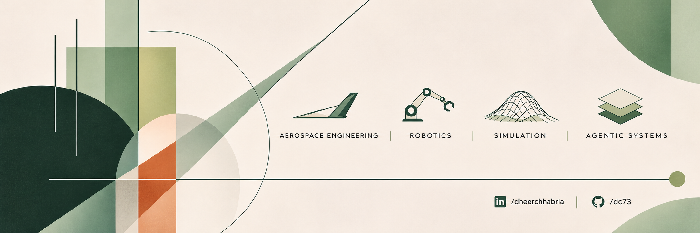

# Dheer Chhabria

I work on space robotics and aerospace simulation, with a focus on autonomous assembly, orbital servicing, and robot perception.

[SRGE Lab at Embry-Riddle](https://erau.edu/research-and-innovation/labs/space-robotics-and-generative-estimation-lab) · [Public repositories](https://github.com/dc73?tab=repositories&type=public) · [LinkedIn](https://www.linkedin.com/in/dheerchhabria/)

## Research

**Autonomous robotic assembly for planetary missions**  
A dual-arm simulation study using LEGO modules to test coordinated assembly in reduced gravity. AIAA SciTech 2026. [Paper](https://doi.org/10.2514/6.2026-2585) · [Symposium presentation](https://commons.erau.edu/db-srs/2025/poster-session/162/)

**HyDroQuad**  
A collaborative drone–quadruped prototype exploring walking and flight for planetary mobility. [Embry-Riddle Discovery Day, 2026](https://commons.erau.edu/discovery-day/db-discovery-day-2026/poster-session/218/) · [Lab flight dynamics tool](https://github.com/srge-erau/hydroquad)

### Lab research repositories

These repositories are private. The summaries describe the research scope.

- **Orbital servicing simulation** — Isaac Sim experiments for a servicing robot that grasps handles, removes modules, and reinserts them. Includes learning runs and held-out tests for the full servicing cycle.
- **Satellite perception and grasping** — Combines RGB-D segmentation and depth geometry to locate candidate grasp regions on satellite hardware.
- **Dual-arm assembly station** — Studies coordinated manipulation with two Franka arms and camera feedback, using modular blocks as stand-ins for space hardware.

## Public projects

| Project | What it does |
| --- | --- |
| [Notebook Press](https://github.com/dc73/notebook-press) | Exports Jupyter notebooks and books to PDF and LaTeX from a cross-platform desktop app |
| [STIM320 Live Monitor](https://github.com/dc73/STIM320-Live-Monitor) | Reads IMU telemetry, plots live signals, and exports logs |
| [Roman L2 Halo](https://github.com/dc73/roman-l2-halo) | Explores halo orbits for the Roman Space Telescope |
| [SRGE Sensor Fusion](https://github.com/dc73/SRGE_sensor_fusion) | Experiments in robotics sensor fusion |
| [3D Heatmap Generator](https://github.com/dc73/3D_Heatmap_Generator) | Generates 3D heatmaps for data exploration |
| [MATLAB Engineering Skill](https://github.com/dc73/matlab-engineering-skill) | Guides numerical validation for MATLAB engineering and simulation code |

## Other private projects

- **CFD mesh tooling** — A C++ desktop workflow for building and inspecting meshes for flow simulation.
- **Quadplane simulation** — CAD-derived simulation assets, sensor models, and flight controller evaluation.
- **Autonomous construction** — Research on modular space structures designed for robotic assembly.
- **Lab operations software** — Scheduling, reporting, and usage analysis tools.

## Languages

| Language | Where I use it |
| --- | --- |
| Python | Robotics simulation, perception, telemetry, and scientific tooling |
| MATLAB | Astrodynamics, orbital simulation, and numerical engineering |
| C++ | CFD meshing and engineering software |
| JavaScript | Browser-based visualization |
| Java | Programming exercises and coursework |

